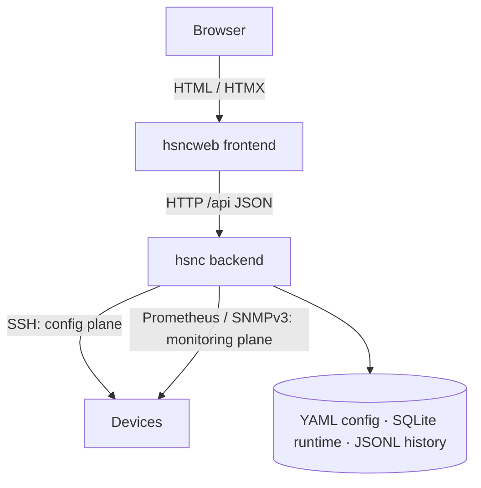
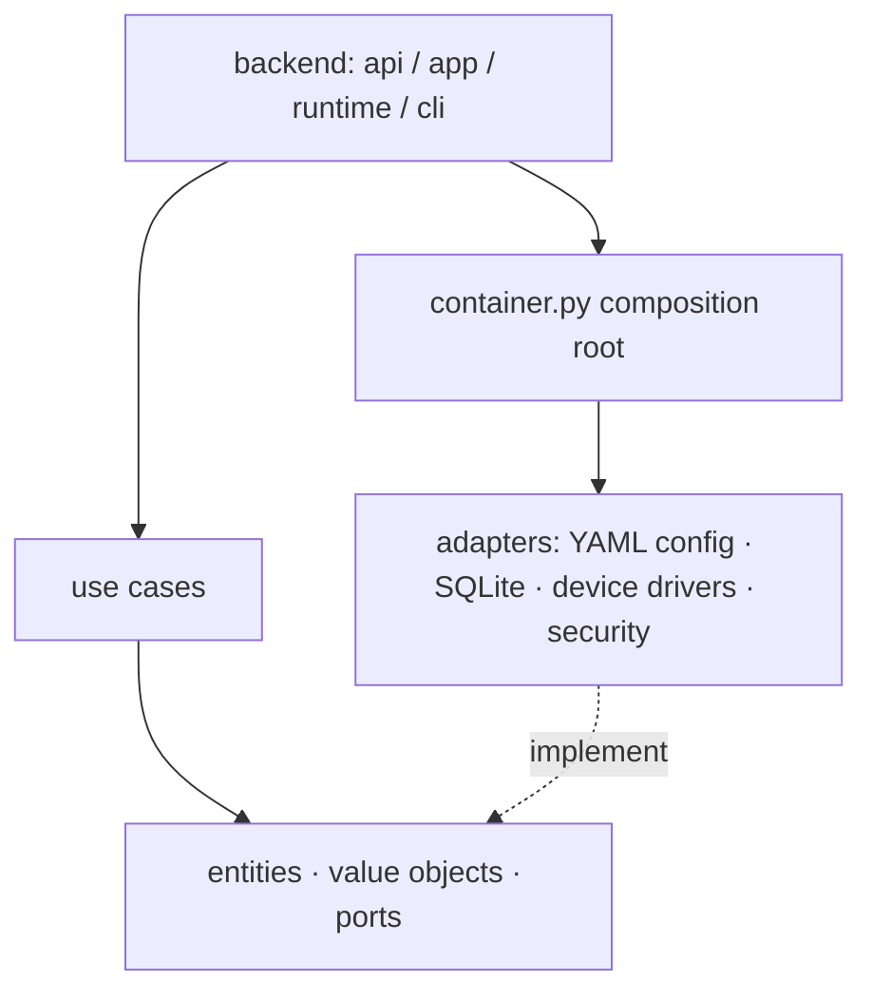
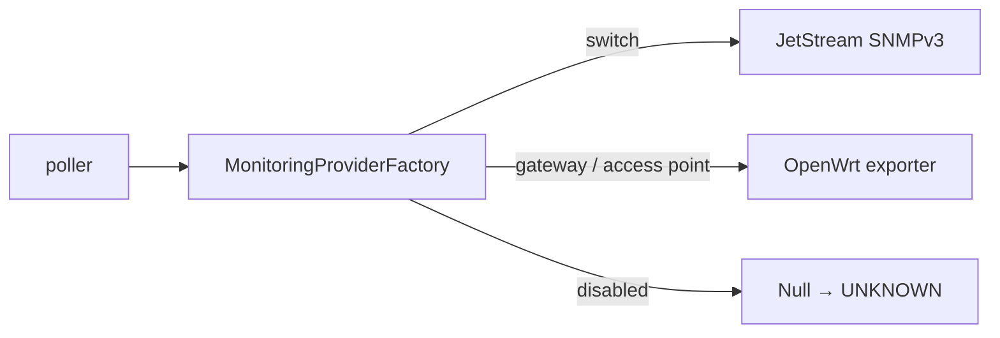

# Architecture

hsnc is two standalone packages — a REST **backend** (`hsnc/`) and a presentation
**frontend** (`hsncweb/`) — that share no code and communicate only over HTTP.

## High level

The frontend opens no device connection and has no database; the backend is the
sole owner of device I/O and persistence.

## Backend layers (Clean Architecture, flat layout)

The dependency direction is strict; modules live flat under `hsnc/src/hsnc/`
rather than in nested layer folders.

- **Core** — `entities.py`, `value_objects.py`, `enums.py`, `interfaces.py`
  (ports). No framework or I/O.
- **Use cases** — one file per operation (`use_cases/`); orchestrate the core.
- **Adapters** — YAML/JSON repos, SQLite runtime store, device drivers, security.
- **Delivery** — Flask REST app, background poller, CLI.
- **Composition root** — `container.py` is the only place wiring concretes to
  ports (selecting mock vs real).

## Two planes

Device access splits into independent planes; the monitoring plane never uses
SSH:

- **Config plane (SSH only):** `DeviceAdapter` — `supports` / `fetch_config` /
  `push_config`. OpenWrt UCI, JetStream CLI.
- **Monitoring plane (non-SSH, per platform):** `MonitoringProvider` —
  `fetch_status` / `fetch_clients`, chosen per device by a
  `MonitoringProviderFactory` from the device kind (OpenWrt gateways/APs →
  Prometheus, JetStream switches → SNMPv3; mock in demo mode; null when polling
  is disabled). There is no SSH fallback.

## Processes & data

The container runs two supervised processes (s6-overlay) sharing `/data`:

- **web** — `gunicorn hsncweb.wsgi:app`; no connections, no DB.
- **api / backend** — `gunicorn hsnc.backend.wsgi:app`; opens config-plane SSH on
  demand and keeps it warm per device (own supervisor thread, independent
  reconnect), closing it once idle past `HSNC_SSH_IDLE_TIMEOUT`; the only writer of
  `runtime.db`, `history.jsonl`, `desired_config.json`, `current_config.json`.

Keeping device I/O off the request path is what keeps the UI fast: an unreachable
device can never block a page.

## Config vs telemetry storage

- **YAML** — declarative inventory/users/site (diff-friendly, hand-editable).
- **SQLite** — runtime telemetry, append/prune, queried per page.
- **JSONL** — append-only apply history.

See the [ADRs](../adr/README.md) for the reasoning behind each choice.
