# User & administrator guide

hsnc is a web controller for a single small network. From one screen you manage
**OpenWrt gateways and access points** and **TP-Link JetStream switches** — their
VLANs, switch ports and Wi-Fi — and watch live status and connected clients.

## What hsnc does

- **Inventory** — one place that lists every managed device and how to reach it.
- **Configuration** — edit VLANs, switch ports and SSIDs in the UI. Changes are
  **staged**, reviewed as a diff, then applied to the hardware on your command.
- **Monitoring** — a dashboard, topology view and live client list, refreshed by
  a background poller.
- **Safety** — a read-only mode (on by default), per-device apply/revert, an
  append-only history, and one-click backups.

## Mental model

hsnc is the **source of truth**. You change config in hsnc; nothing reaches a
device until you click **Apply**.

```mermaid
flowchart LR
    A[Admin] -->|edit| C[hsnc controller]
    C -->|stage pending changes| C
    A -->|Review &#38; Apply| C
    C -->|SSH| D1[OpenWrt gateway / AP]
    C -->|SSH| D2[JetStream switch]
    D1 -->|status &#38; clients| C
    D2 -->|status &#38; clients| C
    C -->|dashboard| A
```

## Roles

| Role | Can do |
| --- | --- |
| **admin** | Everything: edit, apply, manage backups, toggle read-only mode. |
| **viewer** | Read-only access to dashboards, devices and clients. |

Default logins (change immediately): `admin` / `admin` and `viewer` / `viewer`.

## Where to next

1. [Getting started](getting-started.md) — install with Docker and log in.
2. [Managing devices](managing-devices.md) — inventory and monitoring options.
3. [Apply workflow](apply-workflow.md) — stage, review, apply, revert.
4. [Backups](backups.md) — export and restore.

For wiring up real hardware, see [device setup](../devices/README.md).
