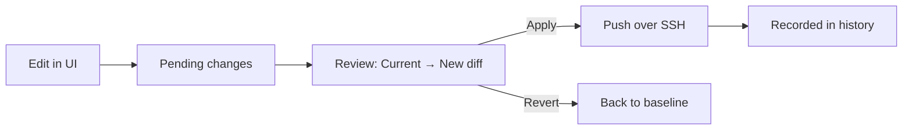

# Reviewing & applying changes

hsnc never pushes edits straight to hardware. Every change to a VLAN, switch port
or SSID is **staged** as a pending change. You review the diff, then apply
exactly when you choose.

## The lifecycle

1. **Edit** VLANs, ports or wireless — saved as *desired* config, not sent.
2. **Review & Apply** (`/config/pending`) shows each device's changes grouped by
   section (General / VLANs / Ports / Wireless) as a **Current → New** diff, plus
   the concrete commands to be sent and a LuCI-style UCI field diff for OpenWrt.
3. **Apply** or **Revert** per device, or **Apply All** / **Revert All**.
4. Each apply is recorded in **history** (`/config/history`).

Nothing reaches a device until you apply.

## Read-only mode (default ON)

As a safety default the controller starts read-only: applying is blocked while
editing and reverting stay available. An admin disables it via the top-bar
**Read-only mode** toggle. Re-enable it after a change window.

## Reverting & re-reading

- **Revert** discards pending changes for a device, restoring the baseline.
- **Re-read** pulls the current config from the device into the baseline — useful
  if a device was changed out-of-band.

## History

The history is an append-only log of applies, baselines and reverts, with the
field-level changes for each. It survives restarts and is included in backups.
