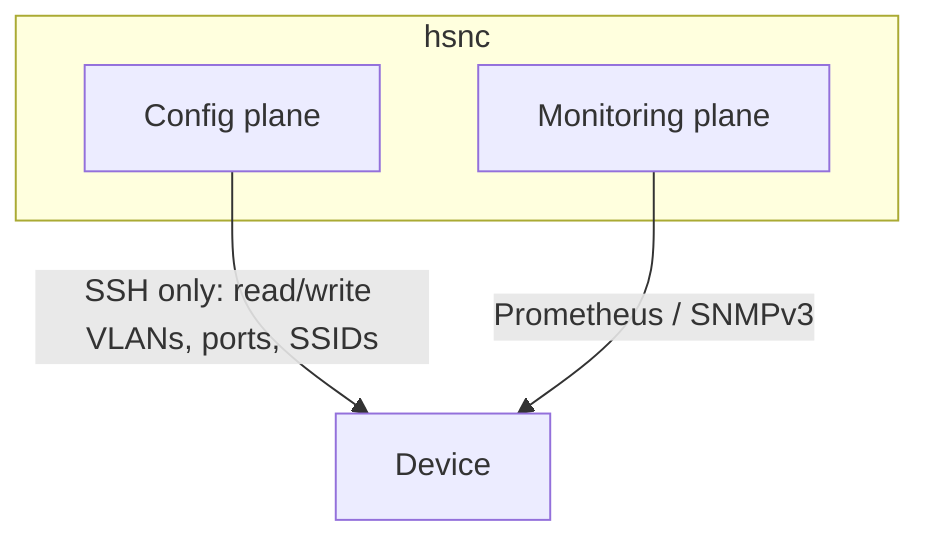

# Managing devices

A device is added to hsnc by listing it in `config/devices.yaml`. That file holds
**connection profiles only** — how to reach each device. The actual configuration
(VLANs, ports, SSIDs, model, firmware) is read from the hardware and stored
separately; it is never hand-written in YAML.

## Inventory entry

```yaml
devices:
  - id: gateway-1            # stable id (used in env-var overrides)
    name: ER605              # display name
    kind: gateway            # gateway | switch | access_point
    ip: 192.168.50.254       # management IP
    site_id: default
    connection:              # SSH access; password comes from the environment
      username: root
      port: 22
    monitoring:              # live polling (optional)
      enabled: true          # false disables polling; device shows "unknown"
```

`devices.yaml` is environment-specific and git-ignored. Copy the shipped template
to start: `cp config/devices.yaml.example config/devices.yaml`.

## The two planes

hsnc reaches a device on two independent channels:



- **Configuration** is always SSH (OpenWrt UCI, JetStream CLI).
- **Monitoring** never uses SSH; the transport is fixed by platform:
  - Prometheus exporter for OpenWrt gateways/APs,
  - SNMPv3 for JetStream switches,
  - set `monitoring.enabled: false` to disable polling (the device shows
    `unknown`).

There is no SSH fallback: an unreachable monitoring endpoint shows `unknown`. Set
up the monitoring transport per platform in [device setup](../devices/README.md).

## Device status

| Status | Meaning |
| --- | --- |
| `connected` | reachable, up |
| `disconnected` | reachable, reported down |
| `unknown` | unreachable or no monitoring source |

One unreachable device never blocks the UI or affects the others.

## Device actions in the UI

- **Re-read** a device to refresh the baseline from the hardware.
- **Quick-edit** name/IP and the connection profile.
- **Delete** a device from the inventory.
- **View SSH connection** to see the live transcript for diagnostics.

Secrets are never stored in the inventory — SSH passwords and SNMP/Prometheus
credentials all come from the environment.
